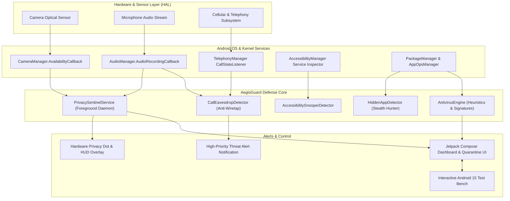

# 🛡️ AegisGuard Mobile Security & Anti-Spyware Fortress

> **Next-Generation Mobile Surveillance Detection, Anti-Wiretapping & Real-Time Antivirus Engine for Android 15 (API 35)**

AegisGuard is an advanced mobile defense system specifically engineered to detect, alert, and neutralize unauthorized surveillance on mobile devices. It protects users against:
- **Silent Camera Snooping**: Secret background camera photo/video capture without user consent.
- **Audio Eavesdropping & Call Wiretapping**: Rogue background audio recording and interception of cellular/VoIP voice calls.
- **Stalkerware & Spyware**: Commercial tracking tools (FlexiSPY, mSpy, Hoverwatch, Spyera, Cerberus, FinSpy, Pegasus variants).
- **Accessibility & Keylogging Abuse**: Trojans exploiting Android Accessibility APIs to record typed passwords, 2FA OTP codes, and screen contents.
- **Malicious APKs & Sideloaded Trojans**: Multi-stage heuristics and signature matching across system packages and storage downloads.

---

## 🏛️ System Architecture



---

## 🔍 How Each Attack Vector is Detected & Blocked

### 1. Camera Monitoring Detection
* **The Threat**: Spyware applications initiate background camera sessions or take periodic snapshots without rendering any preview window on the phone screen.
* **AegisGuard Detection**:
  * Registers a native `CameraManager.AvailabilityCallback` at the system level.
  * When any application opens a camera device, the Android HAL fires `onCameraUnavailable(cameraId)`.
  * AegisGuard immediately inspects the active process UID via `AppOpsManager` (`OP_CAMERA`).
  * If the process does not hold the active foreground window, AegisGuard triggers a **CRITICAL ALERT** with the culprit's package name, alerts the user with an audible chime, and displays the green hardware privacy dot.

### 2. Voice Call Wiretapping & Ambient Audio Snooping
* **The Threat**: Stalkerware (like FlexiSPY, mSpy, or CallSpy) engages an `AudioRecord` hook the moment a phone call is placed or received, recording both the microphone uplink and downlink voice channels.
* **AegisGuard Detection**:
  * Tracks telephony status via `TelephonyManager.CALL_STATE_OFFHOOK`.
  * In Android 10+ (API 29-35), registers `AudioManager.AudioRecordingCallback` to receive `onRecordingConfigChanged(List<AudioRecordingConfiguration>)`.
  * Correlates the active call state with recording clients: if a non-dialer package initiates an audio recording session with audio source `VOICE_CALL`, `VOICE_UPLINK`, `VOICE_DOWNLINK`, or `MIC` during a call, AegisGuard flags it as **CRITICAL: Call Wiretapping in Progress**.
  * Gives the user single-tap power to terminate the offending process and revoke `android.permission.RECORD_AUDIO`.

### 3. Screen Snooping & Keystroke Logging (Accessibility Abuse)
* **The Threat**: Mobile banking trojans and spy apps ask for Accessibility privileges under innocuous names (e.g. "System Update", "Battery Optimizer"), then abuse `AccessibilityService` to read all screen text, capture typed passwords, and steal WhatsApp/Telegram chat logs.
* **AegisGuard Detection**:
  * `AccessibilitySnooperDetector` queries all enabled accessibility services via `AccessibilityManager.getEnabledAccessibilityServiceList()`.
  * Scans for dangerous capabilities:
    * `CAPABILITY_CAN_REQUEST_FILTER_KEY_EVENTS` (Direct Keylogger)
    * `CAPABILITY_CAN_RETRIEVE_WINDOW_CONTENT` (Screen Reader / Chat Spy)
    * `CAPABILITY_CAN_PERFORM_GESTURES` (Automated Click Hijacker)
  * Flags non-system accessibility services and guides the user to disable them immediately.

### 4. Ghost & Stealth Stalkerware Apps
* **The Threat**: Modern commercial stalkerware hides its launcher icon from the Android App Drawer after installation, operating as an invisible background daemon.
* **AegisGuard Detection**:
  * `HiddenAppDetector` enumerates all non-system installed packages and compares them against `pm.queryIntentActivities(Intent.ACTION_MAIN, CATEGORY_LAUNCHER)`.
  * Non-system packages lacking a launcher activity while holding sensitive background permissions (`RECEIVE_BOOT_COMPLETED`, `RECORD_AUDIO`, `SYSTEM_ALERT_WINDOW`, `DEVICE_ADMIN`) are flagged as **Stealth Ghost Stalkerware**.

### 5. Antivirus & APK File Scanner
* **Multi-Stage Heuristic Engine**:
  * Matches package identifiers against a built-in database of known stalkerware and trojans (Pegasus, FinSpy, FlexiSPY, mSpy, Cerberus, Spyera, SpyHide, SharkBot, Anatsa, FluBot).
  * Evaluates **Permission Synergy Risk**: e.g., an app possessing `CAMERA` + `RECORD_AUDIO` + `READ_CALL_LOG` + `SYSTEM_ALERT_WINDOW` receives a Critical 95% risk score.
  * Scans `/storage/emulated/0/Download` for sideloaded `.apk` files and analyzes their manifests prior to installation.

---

## 📂 Repository Structure

```
aegisguard-mobile-security/
├── android-native/                    # Native Android (Kotlin / Jetpack Compose) Project
│   ├── build.gradle.kts               # Root Gradle build script
│   ├── settings.gradle.kts            # Project settings & module definition
│   ├── gradle/libs.versions.toml      # Dependency catalog (Android 15, Compose BOM)
│   └── app/
│       ├── build.gradle.kts           # App-level dependencies & compiler settings
│       └── src/main/
│           ├── AndroidManifest.xml    # Security permissions, services & receivers
│           ├── res/values/            # Strings & Themes
│           └── java/com/aegisguard/security/
│               ├── AegisGuardApp.kt   # Application entry point
│               ├── MainActivity.kt    # Jetpack Compose UI (Dashboard, Scanner, Auditor)
│               ├── service/
│               │   ├── PrivacySentinelService.kt   # Persistent Foreground Service (Cam/Mic)
│               │   └── BootReceiver.kt             # Auto-start on device reboot
│               ├── detector/
│               │   ├── CallEavesdropDetector.kt    # Anti-wiretap audio session analyzer
│               │   ├── CallProtectionReceiver.kt   # Phone state change listener
│               │   ├── AccessibilitySnooperDetector.kt # Keylogger & screen spy auditor
│               │   └── HiddenAppDetector.kt        # Ghost & stealth app finder
│               └── scanner/
│                   ├── AntivirusEngine.kt          # Multi-vector heuristic & signature scanner
│                   └── ThreatModel.kt              # Data models (ThreatItem, RiskSeverity)
│
└── web-app/                           # Responsive Mobile Web App & Interactive Simulator
    └── index.html                     # Complete standalone PWA with cyber-defense styling
```

---

## 🚀 Building & Running

### 1. Interactive Android Test Bench (In Browser)
You can test all security features, simulate attacks, and inspect live logcat logs directly in the interactive Test Bench:
* Open `android_test_bench.html` in the conversation artifact directory.
* Features:
  * **Test Cam Snooper**: Triggers a simulated rogue background camera session; AegisGuard alerts instantly with high-priority HUD banner and privacy dot.
  * **Test Call Wiretap**: Initiates a phone call and injects a rogue `AudioRecord` hook; AegisGuard detects the wiretap and isolates the app.
  * **Deep Antivirus Scan**: Inspects 1,420 files and detects commercial stalkerware signatures.
  * **Device Profiles**: Switch between Pixel 8 Pro, Galaxy S24 Ultra, Pixel 8a, and Pixel Fold.
  * **Live Logcat Stream**: View real-time Android HAL and `AegisGuard` kernel events.

### 2. Native Android Studio Build
To compile the native Android APK:
1. Open the `/android-native` folder in **Android Studio Hedgehog / Ladybug** or newer.
2. Ensure Android SDK 35 (Android 15) and JDK 17 are selected.
3. Build and run on an Android 10+ physical device or emulator:
   ```bash
   ./gradlew assembleDebug
   adb install -r app/build/outputs/apk/debug/app-debug.apk
   ```
4. On first launch, grant the required permissions:
   * **Camera & Microphone**: Required by `PrivacySentinelService` to monitor HAL availability callbacks.
   * **Phone State**: Required by `CallProtectionReceiver` to track phone call lifecycle.
   * **Notification Permission**: Required on Android 13+ to display instant security alerts.
